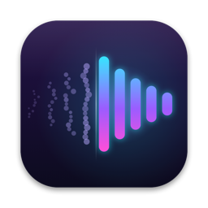

<p align="center"></p>

<h1 align="center">Unbleed</h1>
<p align="center"><b>Your voice, without the game bleeding into it.</b><br>
Real-time removal of game and system audio from your microphone, for streaming on macOS.</p>

---

When you stream from speakers instead of headphones, your mic picks up the game. Unbleed listens to
exactly what your Mac is playing and removes it from your microphone in real time with a neural echo
canceller. OBS then gets a clean voice on **Unbleed Mic** and the game audio on **Unbleed Desktop**,
in sync with each other.

- 🎙️ **Neural echo cancellation:** [DTLN-aec](https://github.com/breizhn/DTLN-aec) (16 kHz) plus a
  reference-aware high band, so your voice keeps its full 48 kHz detail.
- 🔁 **No cables, no routing:** the game reference comes straight from macOS (Core Audio process
  tap). Nothing to set up per game.
- 🎚️ **Two clean outputs:** *Unbleed Mic* (your voice) and *Unbleed Desktop* (everything the Mac
  plays except Unbleed), both delayed by the same ~43 ms so they stay in sync.
- 🧠 **Remembers what it learned:** the canceller saves its state, so the next session starts
  already settled.
- 🩺 **Self-healing:** rebuilds its capture by itself when sample rates, devices or the default output
  change, and logs everything to `~/Library/Logs/Unbleed.log`.
- ✨ **Menu bar app:** live meters, mic picker, launch at login. Signed and notarized installer.

## Requirements

- macOS 14.2 or later (system audio taps), Apple Silicon
- A microphone running at 48 kHz

## Install

1. Open **`Unbleed-1.0.pkg`**. It installs the app into `/Applications` and the two audio devices
   into `/Library/Audio/Plug-Ins/HAL`. Audio pauses for a moment at the end.
2. Open **Unbleed** and allow microphone and system-audio access. A waveform icon appears in your
   menu bar.
3. Pick your mic from the menu (**Microphone ▸**). Unbleed remembers it, and otherwise uses
   macOS's default input.

### OBS

| Source | Device | Notes |
|---|---|---|
| Audio Input Capture | **Unbleed Mic** | your voice |
| Audio Input Capture | **Unbleed Desktop** | game and everything else the Mac plays |
| Screen / window capture | — | turn its audio **off**, otherwise the desktop audio is counted twice |

Keep **audio monitoring off** for these sources: anything OBS plays through your speakers becomes part
of the desktop mix. For lip sync, give your video sources a ~45 ms *Render Delay* filter, or measure
with a clap test.

Suggested filters on *Unbleed Mic*: Compressor (3:1, threshold −24 dB, 6 ms / 60 ms, gain to taste) →
Limiter (−3 dB). Don't add noise suppression or a noise gate; Unbleed already removes the background.

## Using it

The menu bar icon shows status and live levels (mic in, game, voice out), and has the mic picker,
**Launch at Login**, the log and Quit. It turns ⚠️ if no audio is arriving, for example when your mic is
switched off.

Launched from Finder, the Dock or Login Items, Unbleed reads its options from
`~/Library/Application Support/Unbleed/config`, one per line. From a terminal, the same options
work as flags:

```sh
./unbleed --help
./unbleed --mic "Wireless microphone" --output "Unbleed Mic" --desktop-output "Unbleed Desktop"
./unbleed --compare --duration 60 --record take.wav   # neural vs WebRTC side by side, to a WAV
```

## Building from source

```sh
scripts/bootstrap.sh          # Homebrew deps, third-party sources at pinned commits, WebRTC build
./build.sh                    # app, artwork and drivers → build/
./install.sh                  # copy the app to ~/Applications (drivers need the pkg)
packaging/make_pkg.sh         # unsigned installer → build/Unbleed-<version>.pkg
./release.sh                  # signed + notarized + stapled installer
```

`release.sh` needs a **Developer ID Application** and a **Developer ID Installer** certificate in your
login keychain, and notarization credentials stored once with
`xcrun notarytool store-credentials unbleed --apple-id … --team-id …`.

Builds are signed with your Developer ID so macOS keeps the mic and system-audio permissions across
rebuilds. The app bundles ONNX Runtime and its dependencies (`packaging/bundle_libs.py`), so the result
runs without Homebrew.

## How it works

```
                 ┌──────────────── Unbleed (one Core Audio aggregate, one clock) ────────────────┐
 your mic ──────►│ 48 kHz ─► 16 kHz ─► DTLN-aec (ONNX) ─► 48 kHz ─► low band (< 7.5 kHz) ─┐       │
                 │                        ▲                                               ├─► Unbleed Mic
                 │   mic high band ─► steered by DTLN + reference-aware gate ───────────┘       │
 system audio ──►│ (process tap, all apps except Unbleed) ─┬─► reference for both stages        │
   (the game)    │                                          └─► delayed 43 ms ──────────────────► Unbleed Desktop
                 └────────────────────────────────────────────────────────────────────────────┘
```

- **Reference:** a Core Audio *process tap* captures everything the Mac plays except Unbleed itself.
  It shares a clock with the mic through a private aggregate device, so the two never drift apart. A
  tiny helper process plays silence to keep the tap flowing when nothing else is playing.
- **Low band:** DTLN-aec, a two-stage LSTM trained for the AEC Challenge, run through ONNX Runtime in
  8 ms hops (about 5% of one CPU core).
- **High band:** DTLN only works below 8 kHz. Above that, the mic's own high band is gated by how much
  of the 3–7.5 kHz band DTLN kept, refined per frequency by how much the game reference explains.
  One decision-maker means no "musical noise" chirps.
- **Room delay:** the speaker→mic delay that lines the reference up for the high band is measured
  live with GCC-PHAT cross-correlation of mic and game audio. It skips moments when you talk and
  ambiguous windows (repetitive music), and uses the median of recent measurements. It's saved with the
  learned state, so nothing is tuned to one particular room.
- **Outputs:** two virtual devices built from the BlackHole driver source (2 ch, 48 kHz, can't become
  the system default), so nothing else gets routed through them by accident.

### Why neural

Measured on calibration takes (game-only and voice-only recordings, mixed so the clean voice is known):

| | game left while you're silent | voice quality (PESQ, 1–4.5) | voice dropouts |
|---|---|---|---|
| raw mic | −36.5 dB | 1.42 | — |
| Apple voice processing | very low | — | frequent when talking over loud audio |
| WebRTC AEC3 (tuned) | −45.8 dB | 1.95 | few, but audible "garbling" |
| **DTLN-aec + high band (Unbleed)** | **−56.3 dB** | **2.37** (4.41 on voice alone) | none |

In real OBS sessions, game audio left in the voice track while silent sits around −80 to −88 dB.

## Repository layout

```
Sources/Unbleed/    Swift app: capture, engine, supervisor, menu bar
Sources/Neural/     C++ real-time pipeline (DTLN-aec + high band) over ONNX Runtime
Sources/AEC/        C++ bridge to WebRTC AEC3 (the --engine webrtc option)
models/             DTLN-aec 512 converted to ONNX
drivers/            builds Unbleed Mic / Unbleed Desktop from the BlackHole source
branding/           the icon and artwork, drawn in code
packaging/          installer, library bundling, uninstaller
tools/              evaluation and analysis: offline runners, PESQ scoring, OBS track extraction
licenses/           third-party licenses
scripts/            bootstrap
```

## Uninstall

```sh
sudo packaging/uninstall.sh   # removes the app and both devices; keeps settings in ~/Library/Application Support/Unbleed
```

## Credits

- [DTLN-aec](https://github.com/breizhn/DTLN-aec) by Nils L. Westhausen, MIT
- [webrtc-audio-processing](https://gitlab.freedesktop.org/pulseaudio/webrtc-audio-processing), BSD
- [ONNX Runtime](https://github.com/microsoft/onnxruntime), MIT
- The virtual devices are built from the [BlackHole](https://github.com/ExistentialAudio/BlackHole)
  source (GPL-3.0), renamed as its license requires. Unbleed isn't affiliated with Existential Audio.

## License

Copyright © 2026 Nicholas Page ([AndBobsYourUncle](https://github.com/AndBobsYourUncle)).

Unbleed is free software: you can redistribute it and/or modify it under the terms of the
[GNU General Public License v3.0](LICENSE) as published by the Free Software Foundation. It comes
with no warranty.

Third-party components keep their own licenses (MIT, BSD and GPL-3.0); see [`licenses/`](licenses).
